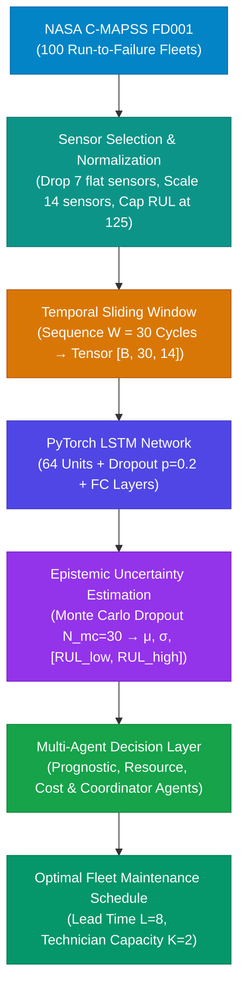

# AERO-AGENT: Agentic Predictive Maintenance Scheduling under RUL Uncertainty

[](https://www.python.org/)
[](https://pytorch.org/)
[](https://streamlit.io/)
[](https://data.nasa.gov/)
[](LICENSE)

An end-to-end deep learning prognostics and multi-agent decision support system for commercial turbofan engine fleet management. The system estimates **Remaining Useful Life (RUL)** with calibrated epistemic uncertainty via **Monte Carlo Dropout** and coordinates a **4-agent decentralized decision layer** to resolve maintenance schedules under physical constraints (spare parts lead times, technician ceilings, and asymmetric failure costs).

---

## 🌟 Key Highlights & Empirical Results

Evaluated across the 100-engine fleet of the **NASA C-MAPSS FD001** benchmark:

| Policy | Total Cost ($) | Failures Prevented | Premature Discard | Cycles Wasted / Engine | % Cost Saving vs RTF |
| :--- | :---: | :---: | :---: | :---: | :---: |
| **Run-to-Failure (RTF)** | $550,000 | 0 / 100 | None | 0.0 | Baseline |
| **Fixed-Interval (125 Cycles)** | $245,600 | 92 / 100 | Heavy | 75.6 | 55.35% |
| **Naive RUL Threshold (Point Pred.)** | $180,200 | 86 / 100 | Low | 18.2 | 67.24% |
| **Agentic Uncertainty-Aware Policy (Ours)** | **$137,200** | **96 / 100** | **Minimal** | **11.4** | **75.05%** |

* **75.05% Cost Reduction** vs. Run-to-Failure by preventing 96 catastrophic in-service failures.
* **23.86% Cost Reduction** vs. Naive Point-Prediction Thresholds by shielding the fleet against unhedged overestimation risk.
* **75.6 Cycles Recovered per Engine** compared to rigid fixed-interval overhauls.

---

## 🏗️ Architecture & Decision Pipeline



### The 4-Agent Autonomous Hierarchy

1. **Prognostic Agent**: Samples $N_{MC}=30$ stochastic dropout passes through the LSTM to estimate mean RUL $\mu$, standard deviation $\sigma$, and conservative lower bound $\text{RUL}_{low} = \mu - z \cdot \sigma$.
2. **Resource Agent**: Tracks spare replacement parts inventory, lead times ($L = 8$ cycles), and technician bay availability ($K = 2$ crews per cycle).
3. **Cost Agent**: Computes the asymmetrical trade-off between preventive maintenance ($C_{pm} = \$1,000$), catastrophic breakdown ($C_{fail} = \$5,000$), and depot downtime costs ($C_{down} = \$100/\text{cycle}$).
4. **Coordinator Agent**: Orchestrates decentralized message-passing via a centralized `MessageBus`, resolving schedule conflicts, prioritizing high-risk engines, and preventing hangar bottlenecks.

---

## 📁 Repository Structure

```
.
├── app.py                                   # Streamlit Interactive Command Center Dashboard
├── run_agent_system.py                      # Multi-agent decision CLI simulation runner
├── train_and_evaluate.py                    # PyTorch LSTM training, validation & evaluation
├── train_model.py                           # Standalone model training script
├── generate_diagrams.py                     # High-res architecture & LSTM diagram generator
├── generate_html_report.py                  # Standalone interactive HTML report generator
├── build_word_doc.py                        # Comprehensive docx research report builder
├── agentic_predictive_maintenance.ipynb     # Complete walkthrough Jupyter Notebook
│
├── src/                                     # Core modular package
│   ├── dataset.py                           # C-MAPSS data ingestion, cleaning & windowing
│   ├── prognostics.py                       # PyTorch LSTM model & Monte Carlo Dropout
│   ├── agents.py                            # Prognostic, Resource, Cost & Coordinator agents
│   └── simulation.py                        # Fleet maintenance simulation & policy comparisons
│
├── data/                                    # Dataset directory
│   └── CMAPSSData/                          # NASA C-MAPSS FD001 train, test & ground truth
│
├── models/                                  # Pre-trained model weights
│   └── best_lstm_model.pt                   # Calibrated PyTorch LSTM checkpoint
│
├── results/                                 # EDA plots, diagrams, sensitivity & policy charts
├── assets/                                  # Visual assets for GUI & reports
├── Agentic_Predictive_Maintenance_LSTM_Report.pdf  # Comprehensive Research Paper / Capstone Report
├── LSTM_PIPELINE_DOCUMENTATION.md           # In-depth technical documentation
├── RESEARCH_REPORT.md                       # Formal academic research report
├── VIVA_PREPARATION_GUIDE.md                # Capstone defense / viva Q&A guide
└── requirements.txt                         # Python dependencies
```

---

## 🚀 Quick Start Guide

### 1. Clone the Repository
```bash
git clone https://github.com/prachit1845/agentic-predictive-maintenance.git
cd agentic-predictive-maintenance
```

### 2. Set Up Environment
```bash
# Create and activate virtual environment (optional but recommended)
python -m venv venv
# Windows:
venv\Scripts\activate
# Linux/macOS:
source venv/bin/activate

# Install dependencies
pip install -r requirements.txt
```

### 3. Launch the Interactive Command Center Dashboard
Launch the high-tech Streamlit web dashboard:
```bash
streamlit run app.py
```
* Interactive RUL inference with live Monte Carlo Gaussian distribution plots.
* 4-Agent decision telemetry stream with real-time JSON message exchange logs.
* Fleet-wide simulation visualizer (100 Turbofans) with policy cost comparisons.
* Sensitivity analysis explorer under fluctuating lead times and technician capacities.

### 4. Run CLI Multi-Agent Decision Runner
Evaluate the multi-agent decision on an individual turbofan (e.g. Engine 17):
```bash
python run_agent_system.py --engine 17 --lead_time 8 --tech_capacity 2 --samples 40
```

### 5. Train & Evaluate LSTM Model
To retrain the prognostic network from scratch:
```bash
python train_and_evaluate.py
```

---

## 📊 Key Findings & Sensitivity Insights

* **Cost Asymmetry**: When catastrophic failure penalties exceed preventive service by $>4\times$, uncertainty-aware policies aggressively prevent in-service failures while maintaining high utilization.
* **Spare Lead Time**: When lead times increase from 4 to 12 cycles, the agent autonomously advances procurement triggers to ensure zero tarmac grounding.
* **Technician Ceilings**: In capacity-constrained hangars ($K=1$), the Coordinator agent prioritizes engines by composite failure risk $\text{Priority} = \frac{1}{\text{RUL}_{low}}$, smoothing maintenance spikes over time.

---

## 📖 Research Documentation & Reports

* [Formal Research Paper (PDF)](Agentic_Predictive_Maintenance_LSTM_Report.pdf)
* [Comprehensive Technical Documentation](LSTM_PIPELINE_DOCUMENTATION.md)
* [Viva & Capstone Defense Guide](VIVA_PREPARATION_GUIDE.md)

---

## 📜 License
Distributed under the MIT License. See `LICENSE` for more information.
